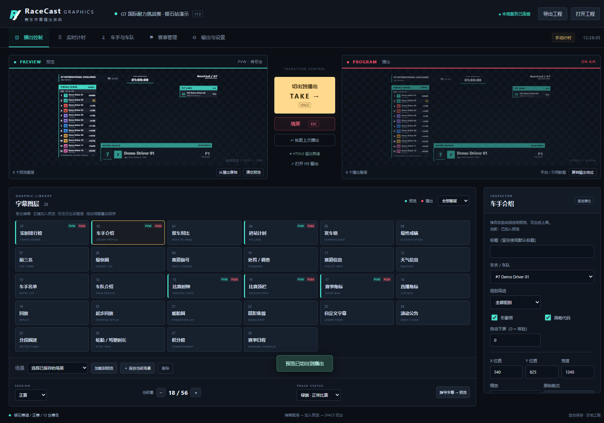
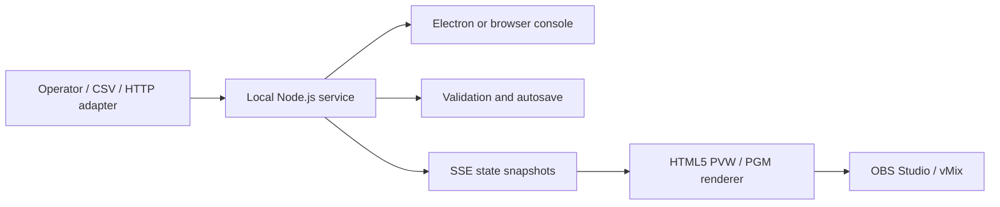

<div align="center">

# RaceCast Graphics

**A local racing broadcast console with PVW/PGM switching, live timing, 28 graphic templates, and transparent HTML5 output.**

[English](README.md) | [简体中文](README.zh-CN.md)


[Quick Start](#quick-start) · [Features](#key-features) · [Graphics Library](#graphics-library) · [User Guide](docs/USER_GUIDE.md) · [API](docs/API.md)

</div>

> [!NOTE]
> The operator interface is currently in Simplified Chinese. This document provides an English guide to the same features.

## Overview

RaceCast Graphics is a Windows desktop application for preparing and broadcasting racing graphics. An Electron console controls a local Node.js service, while dedicated HTML5 pages render preview and program output for OBS Studio and vMix.

The application is designed for local, offline production:

- No cloud account, online font, remote image service, or internet connection is required during operation.
- Event, roster, timing, layout, and output state are managed together.
- Preview and program remain separate until an operator takes a scene or layer.
- Manual entry, CSV files, JSON projects, and a local HTTP API support different production workflows.

All built-in event, driver, team, timing, and points data is fictional sample content.



## Contents

- [Key Features](#key-features)
- [Graphics Library](#graphics-library)
- [Quick Start](#quick-start)
- [Your First Broadcast](#your-first-broadcast)
- [Controls and Shortcuts](#controls-and-shortcuts)
- [HTML5 Output, OBS, and vMix](#html5-output-obs-and-vmix)
- [Timing and Data](#timing-and-data)
- [Projects and Persistence](#projects-and-persistence)
- [Architecture and Security](#architecture-and-security)
- [Development and Verification](#development-and-verification)
- [FAQ](#faq)
- [Scope and Limitations](#scope-and-limitations)
- [Documentation and Contributing](#documentation-and-contributing)

## Key Features

| Area | Included functionality |
| --- | --- |
| Broadcast control | Independent PVW/PGM monitors, full-preview take, single-layer take, single-layer hide, emergency clear, previous-program restore, copy program back to preview, and output pause |
| Layer composition | Movable and resizable layers, scaling, drag-to-reorder stacking, compatible layer composition, automatic mutual exclusion for competing layout groups, and automatic out timers |
| Racing data | Independent practice/qualifying/race sessions, positions, laps, best/last laps, gaps, intervals, sectors, status, tyres, penalties, grid positions, and championship points |
| Pit and stint tools | PIT IN/OUT timestamps, pit count, pit-lane elapsed time, tyre selection, and a new driving stint after pit exit |
| Event management | Event titles, round, circuit, location, length, turns, weather, temperatures, humidity, wind, default ticker text, event logo, session schedule, and race clock |
| Roster management | Unique car numbers, Chinese/English/short names, three-letter nationality codes, teams, categories, cars, team colors, driver photos, and roster search |
| Scene workflow | Named scene presets, preview loading, category filters, list pagination, automatic paging, row-count control, and per-layer data selection |
| Visual customization | Accent/background/text colors, panel opacity, timing font size, name display mode, title/body overrides, X/Y position, width, scale, and default-layout restore |
| Data integration | Manual timing, roster CSV, timing CSV, complete `.racecast.json` projects, local JSON-over-HTTP writes, and Server-Sent Events for state synchronization |
| Output | Transparent 1920 × 1080 HTML5, proportional scaling, full-program or single-layer URLs, black/green backgrounds, and a 90% safe-area guide |
| Local workspace | Autosave, previous-version `.bak`, complete project export/import, embedded images, configurable data directory, and portable-folder storage |
| Desktop operation | Electron app or browser console, single-instance behavior, automatic port fallback, output-window support, and sandboxed renderer pages |

## Graphics Library

All 28 templates share the same live event and timing state. Availability of a field depends on the selected template.

### Timing and race information

| ID | Template | Purpose |
| --- | --- | --- |
| `tower` | Timing Tower | Overall/category order with gap, interval, best lap, last lap, tyre, or laps |
| `sectors` | Sector Times | Selected driver's S1, S2, and S3 data |
| `fastest` | Fastest Lap | Fastest-lap driver and time |
| `battle` | Head to Head | Two-driver comparison |
| `stint` | Stint Info | Tyre and driving-stint information |
| `pit` | Pit Lane | Selected driver's pit state, count, and PIT IN → PIT OUT elapsed time |
| `clock` | Session Clock | Countdown or count-up session clock |
| `topbar` | Session Strip | Compact event, session, and race-progress strip |

### Drivers, teams, and event information

| ID | Template | Purpose |
| --- | --- | --- |
| `driver` | Driver Profile | Driver name, number, team, nationality, photo, and current data |
| `grid` | Starting Grid | Grid order based on each driver's `grid` value |
| `entries` | Entry List | Complete or category-filtered entry list |
| `team` | Team Profile | Team and selected-driver presentation |
| `track` | Circuit Info | Circuit, location, length, turns, and event details |
| `weather` | Weather | Weather, air/track temperature, humidity, and wind |
| `schedule` | Weekend Schedule | Session names and planned times |

### Results and race control

| ID | Template | Purpose |
| --- | --- | --- |
| `results` | Classification | Race results with PROVISIONAL/OFFICIAL state |
| `top3` | Top Three | Leading three entries |
| `championship` | Championship | Points table based on manually supplied points |
| `flag` | Race Control | Green, yellow, double yellow, red, blue, white, chequered, SC, VSC, and FCY states |
| `penalty` | Stewards | Penalty or investigation text for a selected driver |

### Broadcast packaging

| ID | Template | Purpose |
| --- | --- | --- |
| `logo` | Event Bug | Event logo or text bug |
| `corner` | Live Bug | Compact live-production corner label |
| `replay` | Replay | Replay label |
| `startReplay` | Starting Replay | Start-replay label |
| `formation` | Formation Lap | Formation-lap label |
| `highlights` | Highlights | Highlights label |
| `subtitle` | Lower Third | Custom title and body text |
| `ticker` | News Ticker | Scrolling announcement or event notice |

## Quick Start

### Option A: Portable Windows app

1. Obtain or build `RaceCast-Graphics-1.0.0-portable.exe`.
2. Run the executable. No Node.js installation is required.
3. Wait for the first launch to extract its runtime files.
4. Confirm that the console shows **Local service connected**.
5. Keep RaceCast running whenever OBS or vMix uses its output.

For a full-folder build, keep the executable together with `resources`, `locales`, DLLs, and the other generated runtime files.

### Option B: Run from source

Verified development environment: Windows 10/11 x64 and Node.js 24.

```powershell
npm ci
npm start
```

To run the browser console without opening an Electron window:

```powershell
npm run server
```

Open `http://127.0.0.1:9860`.

The desktop app tries ports `9860–9869`. If another process occupies the default port, copy the actual URL from **Output & Settings** instead of assuming port 9860.

### Try the sample workspace

- Use the built-in Silverstone sample to explore the interface.
- Open `examples/演示工程.racecast.json` to restore the sample project.
- Open `examples/空白赛事.racecast.json` to start with a blank event.

## Your First Broadcast

1. **Configure the event** — Enter event, circuit, round, weather, session, and clock information under **Event Management**, then save.
2. **Prepare the roster** — Edit driver cards or import a roster CSV under **Drivers & Teams**. Matching team names automatically group drivers into a team.
3. **Provide timing** — Enter data manually, import timing CSV, or push data through the local API.
4. **Select a graphic** — Click a layer in **Broadcast Control** and edit its properties in the inspector.
5. **Build the preview** — Right-click a layer or choose **Add to Preview**. Add and arrange all layers needed for the scene.
6. **Check PVW** — Confirm positions, sizes, page counts, names, timing values, and transparent areas.
7. **Take to program** — Press **Space** for the full preview, or double-click one layer to take only that layer.
8. **Connect the output** — Copy the `/output` URL into OBS Studio or vMix and verify the result before going live.

### What updates immediately?

Event details, roster data, timing, laps, flags, and official-result confirmation are shared live data. Saving them updates related graphics already on air.

Layer titles, body text, layout, visibility options, and theme settings are preview edits. They reach program only after a full or single-layer take.

## Controls and Shortcuts

| Action | Result |
| --- | --- |
| Click a layer | Select and edit it without changing program |
| Right-click a layer | Add/remove it in preview |
| Double-click a layer | Take that layer immediately while retaining other compatible program layers |
| Drag a layer button | Change preview stacking order |
| **Space** | Take the complete preview to program |
| **Esc** | Clear program immediately; retain preview |
| **1–9** | Toggle the first nine layers in preview while Broadcast Control is active |
| **Ctrl+S** | Export the complete project |
| Copy from Program | Copy the current program scene back to preview |
| Clear Preview | Clear PVW without changing PGM |
| Restore Previous Program | Restore the previous program combination using current live data |
| Hide This Layer | Remove only the selected layer from program |

When an input, textarea, select, or button has focus, **Space** does not trigger a global take. **Esc** remains the emergency clear shortcut; when the driver editor is open, it closes the editor first.

### Scene presets

Save a prepared preview with a name such as `Qualifying`, `Race`, or `Results`. Loading a preset changes preview only, allowing a final check before take. A project can retain up to 12 presets.

### Automatic out and pagination

- **Automatic out** is measured in seconds from the actual take; `0` keeps the layer on air.
- Paginated lists support row count, page number, and automatic page rotation.
- Category filtering recalculates the displayed category order.

## HTML5 Output, OBS, and vMix

### Output URLs

| URL | Purpose |
| --- | --- |
| `/output` | Transparent full-program output |
| `/preview` | Transparent preview; intended for monitoring, not broadcast |
| `/output?layer=tower` | Only the on-air timing tower; replace `tower` with another template ID |
| `/output?background=black` | Black-background layout check |
| `/output?background=green` | Green-background output |
| `/output?guides=1` | 90% safe-area guide for layout checks |

A single-layer URL still follows program state. It remains empty when that layer is off air or global output is paused.

The design canvas is 1920 × 1080 and scales proportionally to the browser viewport. The checkerboard in the console monitors indicates transparency and is not part of the output.

[View a rendered HTML5 output screenshot](artifacts/HTML5字幕输出.png).

### OBS Studio

1. Add a **Browser** source.
2. Paste the actual `/output` URL from RaceCast.
3. Set width to `1920` and height to `1080`.
4. Set 50 or 60 fps to match the production environment.
5. Take a test layer and verify both content and transparency.

### vMix

1. Add a **Web Browser** input.
2. Use the same `/output` URL.
3. Use a 1920 × 1080 canvas.
4. Verify the actual frame rate, layer combinations, and transparent areas before production.

**Pause Output** temporarily clears every output URL while retaining the program combination. **Resume Output** restores the visible program.

## Timing and Data

### Session sorting

| Session/mode | Ordering rule |
| --- | --- |
| Race | Uses the supplied `position`; gap text is not converted into official positions |
| Practice | Valid `bestMs` ascending; entries without a valid lap are placed last |
| Qualifying | Valid `bestMs` ascending; entries without a valid lap are placed last |
| Starting grid | Uses `grid` |
| Championship | Uses manually supplied `points` |

Each session retains its own timing records. Switching sessions clears program, pauses the clock, and stops the demo simulator.

### Timing fields

Depending on the selected view, RaceCast can display and store:

- `position`, `laps`, `bestMs`, `lastMs`
- `gap`, `interval`
- `RUN`, `PIT`, `OUT`, `DNF`, `DNS`, `DSQ`
- `SOFT`, `MEDIUM`, `HARD`, `INTER`, `WET`, `UNKNOWN`
- `s1`, `s2`, `s3`
- Pit count, pit entry timestamp, pit elapsed time, and stint start
- Penalty or investigation text

In the console, laps can be entered as `1:44.326` or `104.326`, and sectors are entered in seconds. CSV and HTTP timing values use integer milliseconds.

### Pit timing

PIT IN records the server timestamp and changes the driver's state to `PIT`. PIT OUT stores the elapsed interval, increments the pit count, and starts a new driving stint.

This measures **PIT IN → PIT OUT**, not stationary tyre-change time.

### Flags, penalties, and results

RaceCast displays operator- or adapter-supplied race-control information. It does not apply sporting penalties, recalculate official positions, award points, or determine champions.

Final results display **PROVISIONAL** until an operator explicitly confirms them as **OFFICIAL**.

### Demo simulation

The demo simulator updates lap times and gaps every 2.5 seconds. It does not simulate a complete race or increment lap counts. Manual or external timing input stops the simulator.

### CSV behavior

- Files use UTF-8, with support for quoted fields, commas, line breaks, and escaped quotes.
- Roster import updates matching car numbers and adds new numbers; it does not delete missing drivers.
- Roster import clears program to prevent mismatched information from remaining on air.
- Timing CSV writes to the current session by car number.
- A timing batch is validated before commit; one invalid row rejects the entire batch.

### Local HTTP API

Writing requires the random token generated for the current application run. Find it under **Output & Settings → Show current API token**, then send it in `X-RaceCast-Token`.

```http
POST /api/timing
Content-Type: application/json
X-RaceCast-Token: <current-run-token>
```

```json
{
  "source": "Timing adapter",
  "rows": [
    {
      "number": "7",
      "position": 1,
      "laps": 19,
      "bestMs": 104326,
      "gap": "LEADER",
      "status": "RUN"
    }
  ]
}
```

See [docs/API.md](docs/API.md) for state snapshots, SSE, project export, control actions, concurrency checks, and complete field rules.

## Projects and Persistence

### Included files

| File | Purpose |
| --- | --- |
| `examples/空白赛事.racecast.json` | Blank event project |
| `examples/演示工程.racecast.json` | Fictional Silverstone sample project |
| `examples/车手导入模板.csv` | Roster CSV template |
| `examples/计时导入模板.csv` | Timing CSV template |

### Project export

Use **Export Project** or **Ctrl+S** to download a complete `.racecast.json` file. It includes:

- Event details and every session's timing data
- Drivers, teams, and embedded photos/logos
- Preview and program layer configurations
- Theme settings and scene presets

Opening a project replaces current data, clears program, and leaves the clock paused. Export the current project first if it is still needed.

### Autosave and backup

- Desktop default: `%APPDATA%/racecast-graphics/projects`
- Source server default: `data/`
- Custom location: set `RACECAST_DATA_DIR`
- Active location: shown under **Output & Settings**

Changes are saved automatically. The previous saved version is retained as `.bak`. A portable-folder distribution can store its profile and projects beside the executable when `portable-mode.json` is present.

Driver photos and event logos support PNG, JPEG, and WebP files smaller than 1 MB. They are embedded in the project, so larger images also increase project size.

## Architecture and Security

### Runtime architecture



The server owns state changes and persistence. The console submits actions and receives revisions. Output pages render the shared state without requiring a rebuild or reload for every timing update.

### Technology

- Electron 44 for the desktop shell
- Node.js built-in modules for HTTP, persistence, tokens, and SSE
- Vanilla HTML, CSS, and JavaScript for the console and graphics renderer
- Playwright for browser and packaged-app verification
- Electron Builder for Windows packages
- No production npm dependencies

### Local security model

- Listens on `127.0.0.1`; no LAN control interface is exposed.
- Validates host and origin for local requests.
- Uses a random per-run token for write actions.
- Disables Node integration and enables context isolation and sandboxing in Electron renderer windows.
- Restricts desktop navigation and new windows to local application pages.
- Does not send race data or images to a cloud service.

Do not expose the API to an untrusted network, place the token on a broadcast graphic, or share it with untrusted pages.

## Development and Verification

### Install and run

```powershell
npm ci
npm start
```

### Available commands

```powershell
npm run server            # Local browser-console server
npm test                  # Model, timing, API, and persistence tests
npm run test:ui           # Browser end-to-end tests using installed Microsoft Edge
npm run package:win       # Windows portable EXE and unpacked directory
node tests/smoke-exe.cjs  # Packaged-app workflow and documentation screenshots
```

### Verified paths

- 12 Node.js tests covering state, timing, validation, persistence, authentication, and SSE
- 3 browser end-to-end tests covering the console, all 28 templates, transparency, CSV, projects, presets, and output controls
- Windows portable and unpacked builds
- Packaged-app startup, pit timing, take, clear, and independent output-window checks

See [docs/验证记录.md](docs/验证记录.md) for the current verification record.

### Project structure

```text
racecast-graphics/
├── electron/             Desktop lifecycle and window security
├── server/               Local HTTP service, validation, and persistence
├── public/               Console, shared model, and HTML5 graphics
├── examples/             Sample projects and CSV templates
├── tests/                Node, browser, and packaged-app tests
├── docs/                 User, API, behavior, and verification documents
├── artifacts/            Application and output screenshots
├── package.json          Runtime metadata and build configuration
└── playwright.config.cjs Browser-test configuration
```

## FAQ

<details>
<summary><strong>Why is my OBS or vMix output empty?</strong></summary>

Confirm that RaceCast is running, the console is connected, the layer is in PGM rather than only PVW, output is not paused, and the browser source uses the current port. For a single-layer URL, also confirm that the selected template is on air.

</details>

<details>
<summary><strong>Why did a property edit not change the program output?</strong></summary>

Layer properties and theme settings require a take. Event, roster, timing, flag, and result-confirmation data update shared graphics immediately after saving.

</details>

<details>
<summary><strong>What happens when port 9860 is occupied?</strong></summary>

The desktop app tries ports 9861–9869. Copy the actual address from Output & Settings and update the OBS/vMix source.

</details>

<details>
<summary><strong>Can another computer control this instance?</strong></summary>

The current service is local-only. It does not provide LAN control and should not be exposed to an untrusted network.

</details>

<details>
<summary><strong>Does the app calculate official results?</strong></summary>

No. Positions, penalties, points, and official confirmation must come from the operator or an authorized timing source.

</details>

<details>
<summary><strong>Where are my projects stored?</strong></summary>

Open Output & Settings to see the active autosave path. Use Export Project to create a portable backup that includes all sessions and embedded images.

</details>

## Scope and Limitations

This release provides local manual, CSV, and HTTP-driven HTML5 graphics. It does not include:

- SDI Fill/Key or DeckLink output
- NDI output
- Video capture or replay recording/playback
- Proprietary timing-provider protocols
- Automatic sporting-rule decisions or official-result certification

Replay templates display broadcast labels only. The portable executable is not commercially code-signed. Test the actual OBS/vMix version, resolution, frame rate, timing source, and layer combinations before a live production.

## Documentation and Contributing

### Documentation

- [中文用户手册](docs/USER_GUIDE.md) — detailed Chinese operating instructions
- [中文 README](README.zh-CN.md)
- [Local data API](docs/API.md)
- [Feature and data behavior](docs/功能分析.md)
- [Verification notes](docs/验证记录.md)

### Contributing

Issues and pull requests are welcome. For a code change:

1. Create a focused branch and install with `npm ci`.
2. Keep changes consistent with the existing vanilla JavaScript and CommonJS structure.
3. Run `npm test` and `npm run test:ui` for affected behavior.
4. For packaged desktop changes, also run `npm run package:win` and `node tests/smoke-exe.cjs`.
5. Use fictional sample data and describe the console and output verification performed.

## License

Distributed under the [MIT License](LICENSE).

© kong1414
