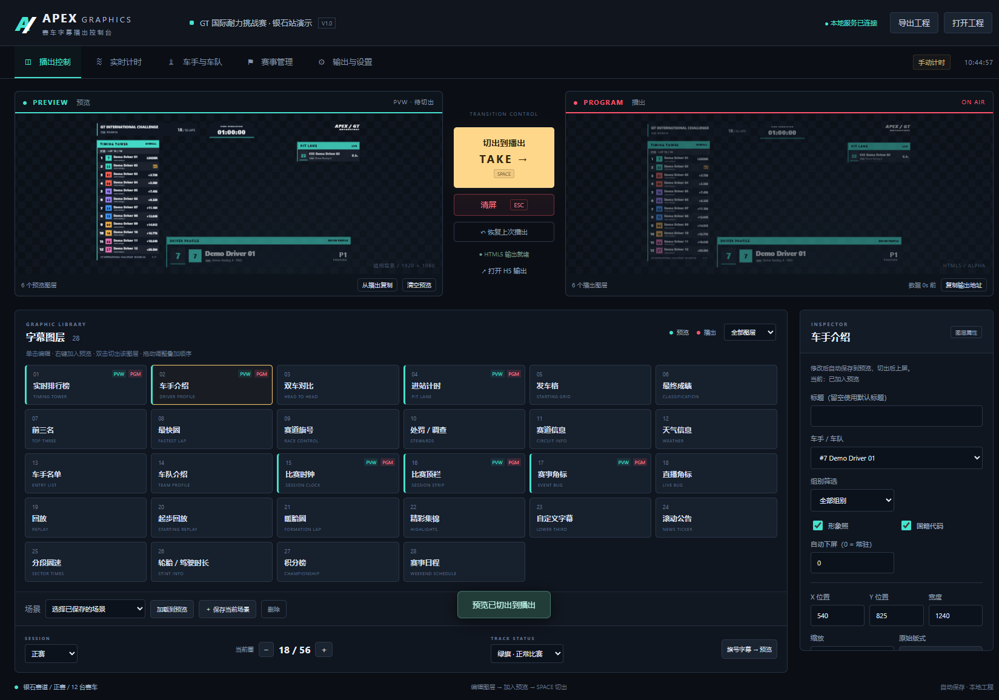

# APEX 赛车字幕播出控制台

[English](README.md) | [简体中文](README.zh-CN.md)

APEX 赛车字幕是一款在 Windows 本机运行的赛事字幕播出工具，提供预览 / 播出工作流、实时计时数据、28 种字幕模板，以及可接入 OBS Studio 和 vMix 的透明 HTML5 输出。

程序完全在本地运行，不依赖云服务、在线字体或远程图片。



## 主要功能

- 预览（PVW）与播出（PGM）双画面，支持整体切出和单图层切出。
- 28 种赛车字幕：实时排行榜、车手介绍、发车格、最终成绩、进站计时、旗号、天气和日程等。
- 手动计时、CSV 导入 / 导出、JSON 工程和本机 HTTP 计时接口。
- 自由练习、排位赛和正赛分别保存计时数据。
- 1920 × 1080 透明 HTML5 输出，支持单图层地址和黑底 / 绿底检查。
- 本地自动保存、上一版本备份、场景预设和完整工程导出。
- 提供 Electron 桌面版与浏览器控制台两种运行方式。

内置赛事、车手、车队、圈速与积分均为虚构演示数据。

## 快速开始

### Windows 便携版

下载或构建 Windows 便携包后，双击 `APEX-Race-Graphics-1.0.0-portable.exe`。便携版不需要安装 Node.js。使用 HTML5 输出期间请保持程序运行。

首次启动时需要解压运行组件，可能需要稍等。

### 从源码运行

环境要求：Windows 10/11 x64，Node.js 24（已验证的开发环境）。

```powershell
npm ci
npm start
```

如果希望在浏览器中使用控制台：

```powershell
npm run server
```

然后打开 `http://127.0.0.1:9860`。桌面版发现 9860 被占用时会尝试 9861–9869，请以「输出与设置」中显示的实际地址为准。

## 基本播出流程

1. 在「赛事管理」填写赛事、赛道、场次、天气和时钟信息。
2. 在「车手与车队」编辑名单，或导入 CSV。
3. 在「实时计时」手动录入、导入计时 CSV，或通过本机 HTTP 接口推送数据。
4. 在「播出控制」单击图层进行编辑；右键图层或点击「加入预览」将其加入 PVW。
5. 按 **SPACE** 或「切出到播出」发布整个预览。双击某个图层可只切出该图层，并保留其他播出图层。
6. 按 **ESC** 或「清屏」立即清空播出，预览保持不变。
7. 在「输出与设置」复制实际输出地址，添加到 OBS 或 vMix。

图层布局、属性和主题先进入预览，切出后才上屏；赛事资料、名单、计时、旗号和官方确认状态会即时同步到已上屏字幕。

## 接入 OBS 和 vMix

### OBS Studio

1. 添加「浏览器」源。
2. 粘贴 `http://127.0.0.1:9860/output`，或软件显示的实际地址。
3. 宽度设为 `1920`，高度设为 `1080`。
4. 帧率选择 50 或 60，与制作环境保持一致。

### vMix

添加 **Web Browser** 输入，使用相同地址和 1920 × 1080 画布。

输出页面背景透明。控制台监视器中的棋盘格只用于表示透明区域，不会进入字幕信号。

| 地址 | 用途 |
| --- | --- |
| `/output` | 透明合成播出 |
| `/preview` | 透明预览，不应作为正式播出源 |
| `/output?layer=tower` | 只输出已上屏的排行榜，可替换为其他模板 ID |
| `/output?background=black` | 黑底版式检查 |
| `/output?background=green` | 绿底输出 |
| `/output?guides=1` | 显示 90% 安全框，用于版式检查 |

## 工程与数据

- `examples/空白赛事.apex.json`：空白赛事工程。
- `examples/演示工程.apex.json`：银石站虚构演示工程。
- `examples/车手导入模板.csv`：名单 CSV 模板。
- `examples/计时导入模板.csv`：计时 CSV 模板。

点击「导出工程」或按 **Ctrl+S** 可下载完整 `.apex.json` 工程。「打开工程」会替换当前数据并清空播出。

桌面版通常保存到 `%APPDATA%/apex-race-graphics/projects`；源码服务器版保存到项目 `data/`。可通过 `APEX_DATA_DIR` 指定其他目录，实际路径以「输出与设置」显示为准。

每次修改都会自动保存，并保留上一个版本的 `.bak` 备份。

## 文档

- [中文用户手册](docs/USER_GUIDE.md) — 详细安装、配置与播出步骤
- [English README](README.md)
- [本机数据接口](docs/API.md)
- [功能与数据规则](docs/功能分析.md)
- [验证记录](docs/验证记录.md)

## 开发与验证

```powershell
npm test                  # 数据、计时、接口与持久化测试
npm run test:ui           # 使用已安装的 Microsoft Edge 做浏览器端到端测试
npm run package:win       # 构建 Windows 便携 EXE 和完整运行目录
node tests/smoke-exe.cjs  # 验证打包程序并更新文档截图
```

目录结构：

- `electron/`：桌面生命周期与窗口安全。
- `server/`：本机 HTTP 服务、状态校验与持久化。
- `public/`：控制台、共享模型与 HTML5 渲染。
- `examples/`：演示工程与 CSV 模板。
- `tests/`：自动化测试。
- `docs/`：用户与接入文档。

## 使用边界

当前版本提供手动、CSV 和本机 HTTP 数据驱动的 HTML5 字幕，不包含 SDI Fill/Key、DeckLink、NDI、视频采集、回放录制或计时供应商私有协议。回放类模板只显示播出标识。

软件不会自动计算官方处罚、积分或成绩。名次与官方确认状态应由操作员或获授权的计时来源提供。便携 EXE 未做商业代码签名。

服务仅监听本机，不要把控制接口暴露到不受信任的网络。

## 许可证

[MIT](LICENSE) © APEX Graphics contributors
