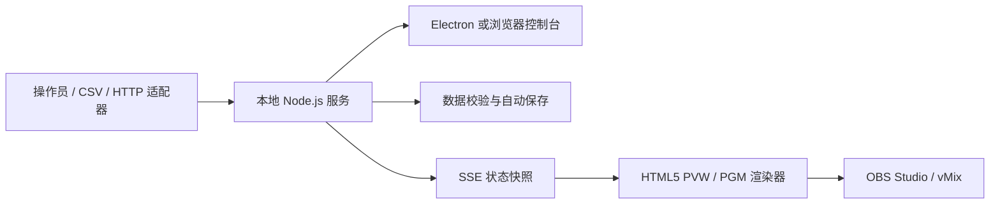

<div align="center">

# RaceCast 赛车字幕播出系统

**在本机完成赛车字幕预览、播出切换、实时计时与 28 种模板渲染，并向 OBS Studio / vMix 提供透明 HTML5 输出。**

[English](README.md) | [简体中文](README.zh-CN.md)


[快速开始](#快速开始) · [功能总览](#功能总览) · [28 种字幕模板](#28-种字幕模板) · [用户手册](docs/USER_GUIDE.md) · [数据接口](docs/API.md)

</div>

## 项目简介

RaceCast 赛车字幕播出系统是一款 Windows 本机播出的赛车字幕工具。Electron 控制台连接本地 Node.js 服务，独立的 HTML5 页面负责预览和播出渲染，可直接作为 OBS Studio 或 vMix 的浏览器源。

软件面向本地、离线制作流程：

- 运行期间不需要云账户、在线字体、远程图片服务或互联网连接。
- 赛事、名单、计时、布局和输出状态统一管理。
- 预览与播出相互独立，只有执行整体或单图层切出后，准备内容才会上屏。
- 支持手动录入、CSV、JSON 工程和本机 HTTP 接口，适配不同的制作方式。

内置赛事、车手、车队、圈速和积分均为虚构演示数据。


## 目录

- [功能总览](#功能总览)
- [28 种字幕模板](#28-种字幕模板)
- [快速开始](#快速开始)
- [完成第一次播出](#完成第一次播出)
- [操作与快捷键](#操作与快捷键)
- [HTML5 输出与 OBS / vMix](#html5-输出与-obs--vmix)
- [计时与数据](#计时与数据)
- [工程与持久化](#工程与持久化)
- [架构与安全](#架构与安全)
- [开发与验证](#开发与验证)
- [常见问题](#常见问题)
- [使用边界](#使用边界)
- [文档与参与贡献](#文档与参与贡献)

## 功能总览

| 功能领域 | 已提供的能力 |
| --- | --- |
| 播出控制 | 独立 PVW/PGM 监视、预览整体切出、单图层切出、单图层下屏、紧急清屏、恢复上次播出、从播出复制回预览，以及暂停输出 |
| 图层组合 | 图层移动、宽度与缩放调整、拖动调整堆叠顺序、兼容图层组合、同组冲突自动互斥，以及自动下屏 |
| 赛车数据 | 练习 / 排位 / 正赛独立计时，名次、圈数、最佳圈、上一圈、领先差、前车差、分段、状态、轮胎、处罚、发车位置和积分榜 |
| 进站与驾驶时段 | PIT IN/OUT 时间戳、停站次数、维修区经过时间、轮胎选择，以及出站后开始新驾驶时段 |
| 赛事管理 | 赛事标题、轮次、赛道、举办地、长度、弯道、天气、气温、赛道温度、湿度、风速、默认公告、赛事标志、场次日程和比赛时钟 |
| 名单管理 | 唯一车号、中英文名、简称、三字母国籍代码、车队、组别、赛车、车队颜色、车手形象照和名单搜索 |
| 场景工作流 | 命名场景预设、加载到预览、组别筛选、榜单分页、自动翻页、行数设置和图层数据选择 |
| 视觉定制 | 强调色、底色、文字色、不透明度、榜单字号、姓名显示方式、标题 / 正文、X/Y 坐标、宽度、缩放和默认布局恢复 |
| 数据接入 | 手动计时、名单 CSV、计时 CSV、完整 `.racecast.json` 工程、本机 HTTP JSON 写入，以及 SSE 状态同步 |
| 输出能力 | 1920 × 1080 透明 HTML5、等比缩放、完整播出 / 单图层地址、黑底 / 绿底检查和 90% 安全框 |
| 本地工作区 | 自动保存、上一版本 `.bak`、完整工程导入 / 导出、图片内嵌、自定义数据目录和便携文件夹存储 |
| 桌面运行 | Electron 或浏览器控制台、单实例运行、端口自动回退、独立输出窗口，以及沙箱化渲染页面 |

## 28 种字幕模板

所有模板共享同一套赛事与计时状态。不同模板会按需使用其中的字段。

### 计时与比赛信息

| 模板 ID | 名称 | 用途 |
| --- | --- | --- |
| `tower` | 实时排行榜 | 总榜 / 组别名次，支持领先差、前车差、最佳圈、上一圈、轮胎或圈数 |
| `sectors` | 分段圈速 | 所选车手的 S1、S2、S3 分段数据 |
| `fastest` | 最快圈 | 全场最快圈车手与成绩 |
| `battle` | 双车对比 | 两位车手的数据对比 |
| `stint` | 轮胎 / 驾驶时长 | 轮胎与当前驾驶时段信息 |
| `pit` | 进站计时 | 所选车手的进站状态、次数和 PIT IN → PIT OUT 经过时间 |
| `clock` | 比赛时钟 | 倒计时或正计时 |
| `topbar` | 比赛顶栏 | 紧凑展示赛事、场次和比赛进度 |

### 车手、车队与赛事信息

| 模板 ID | 名称 | 用途 |
| --- | --- | --- |
| `driver` | 车手介绍 | 姓名、车号、车队、国籍、形象照和当前数据 |
| `grid` | 发车格 | 按车手 `grid` 值展示发车顺序 |
| `entries` | 车手名单 | 完整名单或按组别筛选的名单 |
| `team` | 车队介绍 | 车队与所选车手展示 |
| `track` | 赛道信息 | 赛道、举办地、长度、弯道和赛事资料 |
| `weather` | 天气信息 | 天气、气温、赛道温度、湿度和风速 |
| `schedule` | 赛事日程 | 各场次名称与计划时间 |

### 成绩与赛事控制

| 模板 ID | 名称 | 用途 |
| --- | --- | --- |
| `results` | 最终成绩 | 成绩表及 PROVISIONAL / OFFICIAL 状态 |
| `top3` | 前三名 | 排名前三的车手 |
| `championship` | 积分榜 | 按手动提供的积分展示排名 |
| `flag` | 赛道旗号 | 绿旗、黄旗、双黄旗、红旗、蓝旗、白旗、方格旗、SC、VSC 和 FCY |
| `penalty` | 处罚 / 调查 | 所选车手的处罚或调查说明 |

### 节目包装

| 模板 ID | 名称 | 用途 |
| --- | --- | --- |
| `logo` | 赛事角标 | 赛事标志或文字角标 |
| `corner` | 直播角标 | 紧凑的直播包装角标 |
| `replay` | 回放 | 回放标识 |
| `startReplay` | 起步回放 | 起步回放标识 |
| `formation` | 暖胎圈 | 暖胎圈标识 |
| `highlights` | 精彩集锦 | 集锦标识 |
| `subtitle` | 自定义字幕 | 自定义标题与正文 |
| `ticker` | 滚动公告 | 滚动通知或赛事公告 |

## 快速开始

### 方式 A：Windows 便携版

1. 获取或构建 `RaceCast-Graphics-1.0.0-portable.exe`。
2. 双击运行，无需安装 Node.js。
3. 首次启动需要解压运行组件，请稍等。
4. 确认控制台显示「本地服务已连接」。
5. OBS 或 vMix 使用输出期间，请保持 RaceCast 运行。

如果使用完整文件夹版，请保留 EXE 同目录下的 `resources`、`locales`、DLL 和其他运行文件。

### 方式 B：从源码运行

已验证环境：Windows 10/11 x64，Node.js 24。

```powershell
npm ci
npm start
```

只需要浏览器控制台、不打开 Electron 窗口时：

```powershell
npm run server
```

然后打开 `http://127.0.0.1:9860`。

桌面版会尝试 `9860–9869` 端口。如果默认端口被占用，请复制「输出与设置」中的实际地址，不要继续假设使用 9860。

### 体验演示工作区

- 使用内置银石站演示熟悉界面。
- 打开 `examples/演示工程.racecast.json` 可恢复演示工程。
- 打开 `examples/空白赛事.racecast.json` 可从空白赛事开始。

## 完成第一次播出

1. **配置赛事** — 在「赛事管理」填写赛事、赛道、轮次、天气、场次和时钟，然后保存。
2. **准备名单** — 在「车手与车队」编辑车手卡片或导入名单 CSV。相同车队名称会自动组成车队。
3. **提供计时** — 手动录入、导入计时 CSV，或通过本机接口推送。
4. **选择字幕** — 在「播出控制」单击图层，在右侧属性区编辑。
5. **组织预览** — 右键图层或点击「加入预览」，将当前场景需要的图层全部加入并调整顺序。
6. **检查 PVW** — 核对位置、尺寸、页数、姓名、计时和透明区域。
7. **切出播出** — 按 **SPACE** 发布整个预览，或双击某个图层只切出该图层。
8. **连接输出** — 将 `/output` 地址复制到 OBS Studio 或 vMix，正式播出前先做测试。

### 哪些内容会立即更新？

赛事资料、名单、计时、圈数、旗号和成绩确认状态属于共享实时数据。保存后，已上屏的相关字幕会立即更新。

图层标题、正文、布局、显示开关和主题属于预览编辑，必须执行整体或单图层切出后才会进入播出。

## 操作与快捷键

| 操作 | 结果 |
| --- | --- |
| 单击图层 | 选中并编辑，不改变播出 |
| 右键图层 | 加入或移出预览 |
| 双击图层 | 立即切出该图层，保留其他兼容的播出图层 |
| 拖动图层按钮 | 调整预览堆叠顺序 |
| **SPACE** | 将整个预览切出到播出 |
| **ESC** | 立即清空播出，保留预览 |
| **1–9** | 在播出控制页切换前九个图层的预览状态 |
| **Ctrl+S** | 导出完整工程 |
| 从播出复制 | 将当前播出组合复制回预览 |
| 清空预览 | 只清空 PVW，不影响 PGM |
| 恢复上次播出 | 恢复上一个播出组合，实时数据使用当前值 |
| 下屏此图层 | 只将选中的图层移出播出 |

输入框、文本框、下拉框或按钮有焦点时，**SPACE** 不触发全局切出。**ESC** 仍可用于紧急清屏；车手编辑弹窗打开时优先关闭弹窗。

### 场景预设

可将准备好的预览保存为「排位」「正赛」「赛后」等场景。加载预设只改变预览，仍可在切出前做最后检查。每个工程最多保留 12 个场景预设。

### 自动下屏与翻页

- **自动下屏**以秒为单位，从实际切出时开始计时；`0` 表示常驻。
- 分页榜单支持每页行数、页码和自动翻页。
- 组别筛选后会重新计算组内显示顺序。

## HTML5 输出与 OBS / vMix

### 输出地址

| 地址 | 用途 |
| --- | --- |
| `/output` | 透明完整播出输出 |
| `/preview` | 透明预览，供监看，不作为正式播出源 |
| `/output?layer=tower` | 只显示已上屏的排行榜，可替换为其他模板 ID |
| `/output?background=black` | 黑底版式检查 |
| `/output?background=green` | 绿底输出 |
| `/output?guides=1` | 显示 90% 安全框，用于版式检查 |

单图层地址仍遵循播出状态。该图层未上屏或全局输出暂停时，页面保持无内容。

设计画布为 1920 × 1080，会随浏览器视口等比缩放。控制台监视器中的棋盘格只表示透明区域，不会进入输出。

[查看 HTML5 输出截图](artifacts/HTML5字幕输出.png)。

### OBS Studio

1. 添加「浏览器」源。
2. 粘贴 RaceCast 显示的实际 `/output` 地址。
3. 宽度填写 `1920`，高度填写 `1080`。
4. 帧率设置为 50 或 60，与制作环境一致。
5. 切出一个测试图层，确认内容和透明区域。

### vMix

1. 添加 **Web Browser** 输入。
2. 使用相同的 `/output` 地址。
3. 使用 1920 × 1080 画布。
4. 正式制作前验证实际帧率、图层组合和透明效果。

「暂停输出」会暂时清空所有输出地址，但保留播出组合；「恢复输出」后继续显示当前播出。

## 计时与数据

### 场次排序规则

| 场次 / 模式 | 排序规则 |
| --- | --- |
| 正赛 | 使用提供的 `position`，不根据差距文字反推官方名次 |
| 自由练习 | 有效 `bestMs` 升序，没有有效成绩的车手置后 |
| 排位赛 | 有效 `bestMs` 升序，没有有效成绩的车手置后 |
| 发车格 | 使用 `grid` |
| 积分榜 | 使用手动提供的 `points` |

每个场次独立保存计时。切换场次会清空播出、暂停时钟并停止演示模拟。

### 计时字段

根据不同字幕的用途，RaceCast 可保存并显示：

- `position`、`laps`、`bestMs`、`lastMs`
- `gap`、`interval`
- `RUN`、`PIT`、`OUT`、`DNF`、`DNS`、`DSQ`
- `SOFT`、`MEDIUM`、`HARD`、`INTER`、`WET`、`UNKNOWN`
- `s1`、`s2`、`s3`
- 停站次数、进站时间戳、维修区经过时间和驾驶时段起点
- 处罚或调查说明

控制台圈速支持 `1:44.326` 或 `104.326`，分段以秒录入。CSV 和 HTTP 计时值使用整数毫秒。

### 进站计时

PIT IN 记录服务器时间并将状态改为 `PIT`；PIT OUT 保存经过时间、增加停站次数并开始新的驾驶时段。

这里测量的是 **PIT IN → PIT OUT**，不等于车辆静止换胎时间。

### 旗号、处罚与成绩

RaceCast 展示操作员或适配器提供的赛事控制信息，不自动执行竞赛处罚、重算官方名次、授予积分或判定冠军。

最终成绩默认显示 **PROVISIONAL / 暂定**，只有操作员明确确认后才显示 **OFFICIAL**。

### 演示模拟

演示模拟每 2.5 秒更新圈速与差距，不模拟完整比赛，也不自动增加圈数。任何手动或外部计时录入都会停止模拟。

### CSV 行为

- 使用 UTF-8，支持带引号字段、逗号、换行和双引号转义。
- 名单导入按车号更新已有车手、添加新车号，不删除 CSV 中未出现的车手。
- 名单导入后清空播出，避免不匹配的资料继续上屏。
- 计时 CSV 按车号写入当前场次。
- 计时批次先完整校验再提交，任意一行不合法则整批拒绝。

### 本机 HTTP 接口

写操作需要本次启动生成的随机令牌。在「输出与设置 → 显示本次启动的接口令牌」获取，并放入 `X-RaceCast-Token` 请求头。

```http
POST /api/timing
Content-Type: application/json
X-RaceCast-Token: <本次启动令牌>
```

```json
{
  "source": "计时适配器",
  "rows": [
    {
      "number": "7",
      "position": 1,
      "laps": 19,
      "bestMs": 104326,
      "gap": "LEADER",
      "status": "RUN"
    }
  ]
}
```

状态快照、SSE、工程导出、控制动作、并发校验和完整字段规则见 [docs/API.md](docs/API.md)。

## 工程与持久化

### 随项目提供的文件

| 文件 | 用途 |
| --- | --- |
| `examples/空白赛事.racecast.json` | 空白赛事工程 |
| `examples/演示工程.racecast.json` | 银石站虚构演示工程 |
| `examples/车手导入模板.csv` | 名单 CSV 模板 |
| `examples/计时导入模板.csv` | 计时 CSV 模板 |

### 工程导出

点击「导出工程」或按 **Ctrl+S** 可下载完整 `.racecast.json`，其中包括：

- 赛事资料与所有场次的计时数据
- 车手、车队、内嵌形象照和赛事标志
- 预览与播出图层配置
- 主题设置和场景预设

打开工程会替换当前数据、清空播出并保持时钟暂停。如果当前工程仍需保留，请先导出。

### 自动保存与备份

- 桌面版默认：`%APPDATA%/racecast-graphics/projects`
- 源码服务器默认：`data/`
- 自定义位置：设置 `RACECAST_DATA_DIR`
- 实际位置：在「输出与设置」中显示

每次修改都会自动保存，并保留上一个版本的 `.bak`。便携文件夹版在存在 `portable-mode.json` 时，可将桌面配置和工程保存在软件目录内。

车手形象照和赛事标志支持小于 1 MB 的 PNG、JPEG、WebP。图片会嵌入工程，因此图片体积也会影响工程大小。

## 架构与安全

### 运行架构



本地服务统一负责状态变更和持久化；控制台提交操作并接收版本更新；输出页根据共享状态渲染，无需在每次计时变化后重新构建或刷新页面。

### 技术组成

- Electron 44：桌面外壳
- Node.js 内置模块：HTTP、持久化、令牌和 SSE
- 原生 HTML、CSS、JavaScript：控制台与字幕渲染
- Playwright：浏览器和打包程序验证
- Electron Builder：Windows 打包
- 无生产环境 npm 依赖

### 本机安全模型

- 仅监听 `127.0.0.1`，不开放局域网控制。
- 校验本机请求的主机与来源。
- 写操作使用每次启动生成的随机令牌。
- Electron 渲染窗口关闭 Node integration，启用 context isolation 和 sandbox。
- 桌面导航与新窗口仅允许本地程序页面。
- 不把赛事数据或图片发送到云服务。

不要把接口暴露到不受信任的网络，也不要把令牌放进直播画面或提供给不受信任的页面。

## 开发与验证

### 安装与运行

```powershell
npm ci
npm start
```

### 可用命令

```powershell
npm run server            # 本机浏览器控制台服务
npm test                  # 数据、计时、接口与持久化测试
npm run test:ui           # 使用已安装的 Microsoft Edge 做端到端测试
npm run package:win       # 构建 Windows 便携 EXE 和完整运行目录
node tests/smoke-exe.cjs  # 验证打包程序并更新文档截图
```

### 已验证路径

- 12 项 Node.js 测试：状态、计时、校验、持久化、认证和 SSE。
- 3 项浏览器端到端测试：控制台、全部 28 种模板、透明输出、CSV、工程、预设和输出控制。
- Windows 便携版与完整目录构建。
- 打包程序启动、进站计时、切出、清屏和独立输出窗口。

当前验证详情见 [docs/验证记录.md](docs/验证记录.md)。

### 项目结构

```text
racecast-graphics/
├── electron/             桌面生命周期与窗口安全
├── server/               本机 HTTP 服务、校验与持久化
├── public/               控制台、共享模型与 HTML5 字幕
├── examples/             演示工程与 CSV 模板
├── tests/                Node、浏览器与打包程序测试
├── docs/                 用户、接口、行为与验证文档
├── artifacts/            程序与输出截图
├── package.json          运行元数据与构建配置
└── playwright.config.cjs 浏览器测试配置
```

## 常见问题

<details>
<summary><strong>为什么 OBS 或 vMix 中没有字幕？</strong></summary>

确认 RaceCast 正在运行、控制台已连接、图层已进入 PGM 而不只是 PVW、输出未暂停，并且浏览器源使用当前端口。使用单图层地址时，还要确认对应模板已经上屏。

</details>

<details>
<summary><strong>为什么修改图层属性后，播出画面没有变化？</strong></summary>

图层属性与主题需要执行切出。赛事、名单、计时、旗号和成绩确认数据则在保存后即时更新共享字幕。

</details>

<details>
<summary><strong>9860 被占用时怎么办？</strong></summary>

桌面版会尝试 9861–9869。复制「输出与设置」中的实际地址，并更新 OBS / vMix 浏览器源。

</details>

<details>
<summary><strong>另一台电脑能控制这个实例吗？</strong></summary>

当前服务仅供本机使用，不提供局域网控制，也不应暴露到不受信任的网络。

</details>

<details>
<summary><strong>软件会自动计算官方成绩吗？</strong></summary>

不会。名次、处罚、积分和官方确认必须由操作员或获授权的计时来源提供。

</details>

<details>
<summary><strong>工程保存在哪里？</strong></summary>

在「输出与设置」查看当前自动保存目录。使用「导出工程」可生成包含所有场次和内嵌图片的便携备份。

</details>

## 使用边界

当前版本提供本机手动、CSV 和 HTTP 数据驱动的 HTML5 字幕，不包含：

- SDI Fill/Key 或 DeckLink 输出
- NDI 输出
- 视频采集、回放录制或回放播放
- 计时供应商私有协议
- 自动竞赛规则判定或官方成绩认证

回放类模板只显示播出标识。便携 EXE 未做商业代码签名。正式直播前，请按实际 OBS / vMix 版本、分辨率、帧率、计时来源和图层组合完成联调。

## 文档与参与贡献

### 文档导航

- [中文用户手册](docs/USER_GUIDE.md) — 详细操作说明
- [English README](README.md)
- [本机数据接口](docs/API.md)
- [功能与数据规则](docs/功能分析.md)
- [验证记录](docs/验证记录.md)

### 参与贡献

欢迎提交 Issue 和 Pull Request。修改代码时建议：

1. 创建聚焦单一目标的分支，并运行 `npm ci` 安装依赖。
2. 遵循项目现有原生 JavaScript 与 CommonJS 结构。
3. 对涉及的行为运行 `npm test` 和 `npm run test:ui`。
4. 修改桌面打包相关功能时，再运行 `npm run package:win` 和 `node tests/smoke-exe.cjs`。
5. 使用虚构样例数据，并在提交说明中列出已执行的控制台与输出验证。

## 许可证

基于 [MIT 许可证](LICENSE)发布。

© kong1414
